# AlchemyEngine — アーキテクチャ概要（v2・目標設計）

> **ステータス**: 目標アーキテクチャ（未実装を含む）  
> **現行実装・採用方針の正本**: [../architecture/overview.md](../architecture/overview.md)  
> **v1 との差分洗い出し**: [diff-from-v1.md](diff-from-v1.md)

この文書は、分散連合型 VRSNS を見据えた **目標構成** を一枚の全体図で示す。実装の進捗や現行コードの責務は v1（`architecture/`）を正とする。v1 との **一致・追加・削除・衝突** は [diff-from-v1.md](diff-from-v1.md) を参照する。

---

## 図の読み方（要約）

| ブロック | 役割 |
|:---|:---|
| **運営側 Core Hub** | 認証・規約同意・アセット（Spatial VCS）・容量クォータの必須 SSoT |
| **運営側 Optional Hub** | 決済・マーケット（個人運営では OFF 可／外部マーケットと連合可） |
| **World Operator Node** | world-server（案内・門番・verifier）・zenoh-router・貸し出し host プール |
| **共通契約層** | Protobuf ワイヤ契約・shared-sim・Dual Representation（ノード⇄テキスト） |
| **ユーザーA端末** | launcher が client とローカル host-server を分離起動（画面を閉じてもセッション維持） |
| **ゲスト・マルチプラットフォーム** | ホスト引き継ぎ待機と、単一 Pure Rust からの展開ロードマップ |

通信フロー番号（①〜⑨）は図下部のエッジラベルに対応する。

---

## 全体構成図

```mermaid
flowchart TB
    %% ==========================================
    %% カラースタイル定義
    %% ==========================================
    classDef elixir fill:#4e2a8e,stroke:#d0bfff,stroke-width:2px,color:#fff
    classDef rust fill:#b7410e,stroke:#ffd8a8,stroke-width:2px,color:#fff
    classDef host fill:#d97706,stroke:#fde68a,stroke-width:3px,color:#fff
    classDef launcher fill:#374151,stroke:#9ca3af,stroke-width:2px,color:#fff
    classDef zenoh fill:#005f73,stroke:#94d2bd,stroke-width:2px,color:#fff
    classDef guard fill:#1b4332,stroke:#74c69d,stroke-width:2px,color:#fff
    classDef shader fill:#800f2f,stroke:#ff8fa3,stroke-width:2px,color:#fff
    classDef market fill:#9b2226,stroke:#f4a261,stroke-width:2px,stroke-dasharray: 5 5,color:#fff
    classDef billing fill:#4361ee,stroke:#b8c0ff,stroke-width:2px,stroke-dasharray: 5 5,color:#fff
    classDef vcs fill:#2d6a4f,stroke:#b7e4c7,stroke-width:2px,color:#fff
    classDef storage fill:#2b2d42,stroke:#adb5bd,stroke-width:2px,color:#fff
    classDef shared fill:#3c096c,stroke:#e0aaff,stroke-width:2px,stroke-dasharray: 5 5,color:#fff
    classDef platform fill:#1d3557,stroke:#a8dadc,stroke-width:2px,color:#fff
    classDef local fill:#5f0f40,stroke:#ff70a6,stroke-width:2px,color:#fff

    %% ====================================================================================
    %% 運営側 (OPERATOR SIDE — Stage 1: SQLite単一構成 〜 Stage 4: 大規模連合まで対応)
    %% ====================================================================================
    subgraph OperatorSide["運営側 (Operator Side — 1人運営 [SQLite All-in-One] から大規模運営 [PostgreSQL + 連合] まで伸縮自在)"]
        direction TB

        %% --- 1-A. 必須コア：認証・利用規約同意・Git型アセット局・容量クォータ ---
        subgraph CoreHub["必須コア基盤 (Core Profile — 認証・法務同意・権利・アセットの絶対的SSoT)"]
            direction LR

            subgraph AuthSvc["auth-server (Elixir 1.19 / OTP 28 / Phoenix 1.8 / Ash 3.0)"]
                AuthCore["認証・規約同意・ソーシャル SSoT<br/>・JWT発行 (RS256 / sub = user_id UUID)<br/>・Remember Me (7日スライディング Refresh Token)<br/>・利用規約同意管理 (tos_agreed / tos_agreed_at / tos_version)<br/>・フレンド関係 (Friendship) ＆ グループ所属管理<br/>・/.well-known/jwks.json 公開鍵配信"]:::elixir
                JWKS["/.well-known/jwks.json<br/>RS256 公開鍵配信"]:::elixir
                AuthDB[("Ash DataLayer<br/>・Stage 1 (個人): SQLite<br/>・Stage 2+ (拡大): PostgreSQL 16+")]:::storage
                AuthCore --> AuthDB
                AuthCore --> JWKS
            end

            subgraph AssetsVCS["assets-server (Elixir / Ash + Git型 Spatial VCS + 軽量検疫)"]
                QuotaGate["ストレージ上限ゲート (Quota Enforcer)<br/>・$0: 1GB ｜ $1: 5GB ｜ $5: 25GB<br/>・$10: 50GB ｜ $20: 100GB + グループ共有 50GB<br/>※マーケット購入品は購入者の容量を消費しない設計"]:::elixir
                InvVCS["インベントリ ＆ Git管理 (Spatial VCS)<br/>・個人Vault / グループ共有Vault のフォルダ階層整理<br/>・構成ツリー (AlchemyPrefab / WorldManifest)<br/>・Git操作: Commit / Branch / Tag / Diff / Fork<br/>・原産地証明 (Origin Cert: 作者sub + CommitHash) 電子署名"]:::vcs
                ServerVerify["アップロード検疫 ＆ 盗品検知<br/>・クライアント側でビルドされたGLB/KTX2の軽量ヘッダ検証<br/>・3D特徴量(ボーン構造/UV/pHash)による頂点ずらし盗品検知"]:::guard
                R2Storage[("Cloudflare R2 (CAS)<br/>下り通信量(Egress)完全無料<br/>BLAKE3ハッシュ不変バイナリ配信")]:::storage

                QuotaGate --> InvVCS --> ServerVerify --> R2Storage
            end
        end

        %% --- 1-B. オプション拡張：MoR/プリペイドコイン決済 ＆ 連合マーケット ---
        subgraph OptionalHub["オプション拡張基盤 (Optional Profile — 個人運営ではOFF可能 / 外部マーケットと連合可能)"]
            direction LR

            subgraph BillingSvc["決済 ＆ コインウォレット基盤 (BillingProvider)"]
                BillingMod["MoR / Stripe 連携 ＋ プリペイドコイン方式<br/>・少額決済の手数料負けを防ぐコインチャージ (有効期限180日以内)<br/>・資金決済法/特商法に基づく規約同意(tos_version)を必須化<br/>・コイン消費でストレージQuota即時拡張 ＆ アセット購入"]:::billing
            end

            subgraph MarketSvc["market-server (Elixir / Phoenix / Ash)"]
                MarketCore["BOOTH風アセットストア ＆ 権利・連合管理<br/>・ワールド / アバター / シェーダー / ギミックを Git Tag単位で売買<br/>・購入利用権証書 (License Token: 購入者sub紐付け) 署名発行<br/>・新規出品者の売上14日間エスクロー (不正時は自動返金＆凍結)<br/>・連合ポリシー: Trusted(相互検索) / Blocked(悪質マーケット即時遮断)"]:::market
            end

            BillingMod <--> MarketCore
            BillingMod -.->|"プラン容量枠の即時更新"| QuotaGate
            MarketCore <-->|"Tag参照・インベントリ即時反映"| InvVCS
        end

        %% --- 1-C. ワールドサーバー（検証アプリ内蔵）・Zenoh中継・貸し出しホストプール ---
        subgraph WorldAndRelayNode["ワールド運営・検証・Zenoh中継ノード (World Operator Node ※他運営者ノードと連合可能)"]
            direction LR

            subgraph WorldServer["world-server (100% Pure Elixir Umbrella — NIF完全廃止・案内所・門番・改ざん検証)"]
                WorldDir["apps/core & network & contents<br/>・Worldタブ一覧配信 ＆ 他運営者サーバーとの連合リスト交換<br/>・alchemy:// ディープリンク解決 (URL 1つで特定座標へ直ワープ)<br/>・/.well-known/alchemy-node-info.json (機能ディスカバリ)<br/>・公開範囲判定 (Private/LAN/Friends/Friends+/Public) ＆ Room Token発行<br/>・空間オーディオの『指揮者』として非同期コマンド発行"]:::elixir
                HostVerifier["apps/verifier: 改ざん監査 ＆ スマート死活監視フェイルオーバー (新設)<br/>・【メモリ改ざん前提の監査】空間台帳(Scene Manifest)を署名管理し、<br/>ローカルホストの20Hzフレームを抜き打ち監査(Spot-Check)。改ざん検知時は権限即時剥奪！<br/>・【見る権利と着る権利の分離】アバター表示は全員即時OK、着用・配置のみLicense Token検証！<br/>・【スマートホスト移譲】client_info の『引き受けON/OFF』と『PC性能(CPU/RAM/Ping)』を監視し、<br/>ホスト終了/突然死時は『予備ヘッドレスB/C』または『最高性能PCゲスト』へ0秒で自動移行！"]:::guard
                RentalMgr["貸し出し host-server 制御<br/>重たいワールドや24時間常設部屋向けにクラウドホストを貸し出し"]:::elixir
                WorldDir --> HostVerifier --> RentalMgr
            end

            subgraph ZenohInfra["zenoh-router (zenohd メッシュルーター)"]
                ZenohRelay["Zenoh 統合通信メッシュ (Native: QUIC/TCP ｜ Web: WebTransport/WebSocket)<br/>・経路① [空間同期]: host-server が1回送った 20Hz RenderFrame を全参加者へ一斉配信 (Fan-out)<br/>・経路② [Zenoh Audio Streaming]: Opus音声をQUIC Datagramで参加者間に直接低遅延中継<br/>・経路③ [セキュアP2Pキャッシュ]: ルーム参加者間でアセットチャンクをIP秘匿融通"]:::zenoh
                ZenohFed["別運営者の zenoh-router"]:::zenoh
                ZenohRelay <-->|"Federation Mesh"| ZenohFed
            end

            subgraph CloudHostPool["運営側 host-server プール (100% Pure Rust — 貸し出し・常設用)"]
                HeadlessPool["クラウド host-server A / B / C (冗長構成)<br/>重いワールドの貸し出し時や常設パブリック稼働時に動作。<br/>ヘッドレスAが落ちても予備B・Cへ無停止フェイルオーバー！"]:::host
            end

            RentalMgr ===>|"起動・冗長切替"| HeadlessPool
            HeadlessPool <===>|"20Hz Frame"| ZenohRelay
            HostVerifier <===>|"抜き打ち監査・死活監視・昇格指令"| ZenohRelay
        end
    end

    %% ====================================================================================
    %% 共通契約・共有クレート層 (SHARED CONTRACTS & CRATES)
    %% ====================================================================================
    subgraph SharedLayer["共通契約・同一バイナリ基盤 (運営側・ユーザーPC側・全環境で単一ソースを共有)"]
        direction LR
        ProtocolRepo["protocol (alchemy-protocol)<br/>Protobuf (.proto) ワイヤ契約 SSoT (PROTOCOL_PIN)<br/>render_frame(binary64) / input_events / client_info(性能・Host可否)"]:::shared
        SharedSimCrate["host-server / shared-sim (100% Pure Rust)<br/>Rapier3d物理・空間状態(単精度f32)・Formula VM・binary64境界変換<br/>PC: 独立裏プロセス起動 ／ Web・Mobile・Quest: インプロセス(Worker)起動"]:::shared
        DualCodeSpec["Dual Representation (ノード ＆ テキスト両対応規格)<br/>・シェーダー: 3D空間ノードグラフ(DAG) ⇄ WGSLテキスト関数 (共通AST ➔ Naga検証)<br/>・空間ギミック: Formulaノードグラフ ⇄ Formulaスクリプト (共通AST ➔ Formula VM)"]:::shader
    end

    %% ====================================================================================
    %% クライアント側：ユーザーAの端末（別プロセス分離 ＆ クライアント側LODビルド）
    %% ====================================================================================
    subgraph HostUserPC["クライアント側：ユーザーAの端末 (PCでは別プロセス分離で画面を閉じてもワールド維持)"]
        direction TB

        LauncherApp["launcher (alchemy-launcher — プロセス管理 ＆ alchemy:// URIディープリンク起動)<br/>・client(画面) と ローカルhost-server(裏プロセス) を分離起動・監視<br/>・ユーザーが client(画面) を閉じても、裏プロセスの host-server は稼働し続けセッション維持！<br/>・PC電源OFF時は、部屋に残っている高スペックなゲストB・C(または予備ヘッドレス)へホスト権限を委譲"]:::launcher

        %% --- プロセス1：ローカル host-server ---
        subgraph LocalHostProc["別プロセス①：ローカル host-server (PC: 独立裏プロセス ／ Web・Quest: インプロセス Worker)"]
            LocalHost["ローカル空間計算ホスト (100% Pure Rust / 権威Tick: 20Hz)<br/>・【Untrusted前提】物理・座標の計算係に徹し、world-server(verifier)の抜き打ち監査を受ける<br/>・全入力の Room Token 検証 ＆ 全浮動小数点の is_finite() サニタイズ (NaN/Inf物理発散攻撃を遮断)<br/>・Rapier3d物理・衝突判定・Formula VM 実行 ➔ 描画境界 binary64(f64) の RenderFrame 生成<br/>・Private時はローカルIPCのみ(運営費0円) / Public・Friends時は zenoh-router へ1回Publish"]:::host
        end

        %% --- プロセス2：クライアント本体（VRAlchemy） ---
        subgraph ClientProc["別プロセス②：client (VRAlchemy — 100% Pure Rust 体感・描画・作成・LODビルドプロセス)"]
            direction TB

            BootAndLocal["① 起動・VR自動判定 ＆ ローカルファイル入力 (app / window / xr)<br/>・OpenXR接続あり ➔ VRモード ／ 接続なし ➔ Desktopモード (最初はPrivateでホームを0秒起動)<br/>・ローカルファイル (.glb/.png/.ogg) D&D ＆ 3Dインゲーム・ファイルブラウザ"]:::local

            SpatialMenuUI["② メニューパネル (system_ui — メニューボタン or ESCキーで表示)<br/>・Worldタブ: 5段階公開範囲 ＆ 『ホスト引き受け(死活監視移行) ON/OFF』トグル ＆ 貸し出しホスト選択<br/>・Inventory(個人/グループ共有): 閲覧・フォルダ整理・3D空間への配置・空間内Prefabの逆保存<br/>・Git履歴タブ: Commit / Branch切替 / 3D空間Diff / Rollback<br/>・Shop ＆ プラン管理タブ: 規約同意(tos_version)・コインチャージ・容量拡張・アセット購入0秒着用"]:::vcs

            DualEditor["③ Dual Editor (ノード ＆ テキスト両対応シェーダー/ギミック作成)<br/>・公式標準マテリアルもノードとして開いて改造(Fork)可能<br/>・ノード派は3D空間で結線、コード派はテキストでWGSL関数/Formulaスクリプトを記述<br/>・DAG循環(無限ループ)排除・GPU負荷上限チェック ➔ wgpu内蔵『Naga』(Pure Rust)でミリ秒検証＆即時反映"]:::shader

            LocalAssetBuilder["④ クライアント側アセットLODビルダー ＆ UX最優先セキュアキャッシュ (assets)<br/>・RCE完全防御デコーダ (#![forbid(unsafe_code)]): 音声 Symphonia / 3D gltf / 画像 image(KTX2)<br/>・【サーバーCPU代0円】インポート/Commit時に自PCのパワーで『PC高画質版』と『Quest/Web軽量LOD(KTX2)』をローカルビルド！<br/>・【UX最優先P2Pキャッシュ】同じ部屋の他人の有料アバターも鍵待ちなしでP2P/R2から即時取得＆プログレッシブ0秒表示！<br/>（パーサー投入前のBLAKE3ハッシュ照合で毒データを100%破棄 ＆ ローカルディスク保存時はChaCha20難読化）"]:::guard

            ClientAV["⑤ 実行・体感エンジン (shared-sim / render / audio)<br/>・20Hz権威フレームの間を ~60-120fps で予測・補間<br/>・wgpu 描画 (binary64空間座標レンダリング)<br/>・Zenoh Audio DSP (SuperCollider着想の低遅延空間オーディオ合成・Opus送受信)"]:::rust

            BootAndLocal & SpatialMenuUI & DualEditor & LocalAssetBuilder --> ClientAV
        end

        LauncherApp ===>|"バックグラウンド維持"| LocalHostProc
        LauncherApp ===>|"起動・終了制御"| ClientProc
        LocalHost <===>|"ローカルIPC (0ms遅延)"| ClientProc
    end

    %% ====================================================================================
    %% クライアント側：ゲスト端末（スペック判定付きフェイルオーバー待機）＆ 展開環境
    %% ====================================================================================
    subgraph GuestAndPlatforms["クライアント側：ユーザーB・C (ゲスト参加 ＆ ホスト引き継ぎ待機) ＆ マルチプラットフォーム"]
        direction TB

        GuestClient["ユーザーB・Cの端末 (client + 待機中の host-server)<br/>・入室した瞬間に全員のアバター(有料含む)をP2P/R2からプログレッシブ取得して待ち時間0秒で表示！<br/>・client_info で『ホスト引き受けON/OFF』と『PCスペック余裕度』を world-server(verifier) へ定期通知<br/>・ホストAが終了(または突然死/改ざん剥奪)した際、引き受けONかつ高スペックなBが<br/>直前まで受信していた最新フレームを初期状態として0秒で新ホストへ自動昇格！"]:::rust

        subgraph TargetPlatforms["単一 Pure Rust コードベースからのマルチプラットフォーム展開ロードマップ"]
            direction LR
            P1["Step 1: Windows<br/>DX12/Vulkan + OpenXR"]:::platform
            P2["Step 2: Linux / macOS<br/>Vulkan/Metal + OpenXR"]:::platform
            P3["Step 3: Web (Browser)<br/>Wasm32 + WebGPU + WebXR<br/>(Zenoh over WebTransport)"]:::platform
            P4["Step 4: Android / iOS<br/>Vulkan/Metal + Touch/AR"]:::platform
            P5["Step 5: Quest等 Standalone VR<br/>Android Vulkan + OpenXR<br/>(軽量KTX2/LODアセット自動取得)"]:::platform
            P1 --> P2 --> P3 --> P4 --> P5
        end
    end

    %% ====================================================================================
    %% 全体通信フロー
    %% ====================================================================================
    AuthCore -.->|"① JWT発行 ＆ 規約同意(tos_version)確認"| LauncherApp & GuestClient
    JWKS -.->|"公開鍵(RS256)による署名検証"| HostVerifier & QuotaGate & MarketCore & ClientProc & GuestClient
    LocalAssetBuilder ===>|"② 自PCでLODビルド済みのアセットをGit Commit / 保存 (Quota検査)"| QuotaGate
    R2Storage -.->|"③ R2から高速配信 (Egress無料)"| LocalAssetBuilder & GuestClient
    LocalAssetBuilder <===>|"④ セキュアP2Pキャッシュ高速融通 (BLAKE3事前照合・全員即時表示)"| ZenohRelay
    SpatialMenuUI & GuestClient <===>|"⑤ World一覧 / Room Token取得 / 着用権検証 / client_info(性能・Host可否)通知"| WorldDir & HostVerifier
    LocalHost ===>|"⑥ 20Hz RenderFrame(binary64) を1回Publish"| ZenohRelay
    ZenohRelay ===>|"⑦ 全参加者へ一斉配信(Fan-out) ＆ world-server(verifier)が抜き打ち監査"| GuestClient & ClientAV & HostVerifier
    ClientAV & GuestClient <===>|"⑧ Zenoh Audio Streaming (Opus over QUIC Datagram 直結)"| ZenohRelay
    GuestClient ===>|"⑨ 移動・アクション・空間編集入力 (with Room Token)"| ZenohRelay ===>|"入力転送"| LocalHost & HeadlessPool
    HostVerifier -.->|"ホスト死活断/改ざん検知 ➔ 引き受けONの高スペックB(または予備ヘッドレス)へ即時移行指令"| GuestClient & HeadlessPool

    %% 共通層のリンク
    ProtocolRepo -.-> WorldServer & CloudHostPool & LocalHostProc & ClientProc & GuestClient
    SharedSimCrate -.-> HeadlessPool & LocalHost & ClientAV & GuestClient
    DualCodeSpec -.-> InvVCS & DualEditor
```

---

## 関連ドキュメント

- [現行アーキテクチャ概要（v1・正本）](../architecture/overview.md)
- [v1 との追加・削除・衝突](diff-from-v1.md)
- [最終ゴール・Phase ロードマップ](../vision-goal.md)
- [ビジョンと設計思想](../vision.md)
