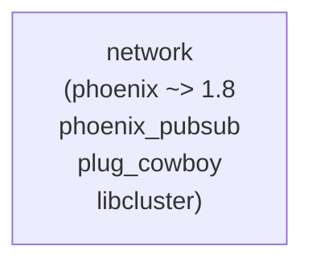

# Elixir: network — 通信レイヤー

> **ステータス**: 現行実装の記述  
> **目標**: [architecture-v2/](../../architecture-v2/)  
> **決定済みの上書き**: [diff-from-v1.md](../../architecture-v2/diff-from-v1.md) §2.1（**C9**: 転送は Zenoh 一本化。`Network.UDP.Protocol` / 空間同期用 Phoenix は廃止方向。案内・Room Token・verifier 連携へ寄せる）を優先  
> **読む順**: [architecture-v2/README.md](../../architecture-v2/README.md)

## 概要

`network` は **現行**では Phoenix Channels（WebSocket）・UDP トランスポート・Zenoh フレーム配信を提供します。ローカルマルチルーム管理により、OTP 隔離などに利用されます。  
**目標（C9）**: Network Transport は Zenoh のみ。`Network.UDP.Protocol` / 空間同期用 Phoenix は廃止方向。責務は案内・Room Token・verifier 連携へ寄せる（OSC 入力エッジはクライアント側）。

### 目標責務（v2）

| 残す | 外す（廃止方向） |
|:---|:---|
| Zenoh ブリッジ（または host 発行 Frame の監査購読） | `Network.UDP` / `Network.UDP.Protocol` による空間同期 |
| `Network.RoomToken`・入室ゲート | 空間同期用 Phoenix Channel を正面経路にする記述 |
| S2S / ワールド一覧・連合リスト | — |
| verifier 連携（Spot-Check・死活） | — |

---

## モジュール一覧

| モジュール | 説明 |
|:---|:---|
| `Network` | 公開 API。Distributed / Local / Channel / UDP へ委譲 |
| `Network.ZenohBridge` | Zenoh フレーム publish・入力 subscribe。`config :network, :zenoh_enabled, true` で起動。`publish_frame(room_id, frame_binary)` でフレーム配信。`game/room/*/input/movement`・`game/room/*/input/action` で入力受信し、`Contents.Events.Game` へ配送 |
| `Network.Distributed` | 複数ノード間ルーム管理。libcluster クラスタ時は分散配置・RPC ブロードキャスト。単一ノード時は Local へ委譲 |
| `Network.Local` | ローカルマルチルーム管理 GenServer（OTP 隔離） |
| `Network.RoomToken` | Phoenix.Token によるルーム参加認証（WebSocket join 時のトークン検証） |
| `Network.Channel` | Phoenix Channels / WebSocket チャンネル |
| `Network.Endpoint` | Phoenix Endpoint（ポート 4000） |
| `Network.UDP` | UDP サーバー（ポート 4001） |
| `Network.UDP.Protocol` | UDP プロトコル定義 |

---

## `Network` 公開 API（Distributed へ委譲）

| 関数 | 説明 |
|:---|:---|
| `open_room/1` | 新しいルームを起動 |
| `close_room/1` | ルームを停止 |
| `register_room/1` | 既存プロセスを接続テーブルに登録 |
| `unregister_room/1` | 接続テーブルからルームを解除 |
| `connect_rooms/2` | 2 つのルームを双方向接続 |
| `disconnect_rooms/2` | 接続を解除 |
| `broadcast/2` | 指定ルームとその接続先にイベントを配信 |
| `list_rooms/0` | 起動中ルーム一覧 |
| `connected?/2` | 2 ルームが接続されているか |

## `Network.RoomToken`

ルーム参加用トークンの生成・検証。`Phoenix.Token.sign/verify` を使用。`Network.Channel` の join 認証に利用。

---

## 依存関係・設定

- **libcluster**: `config :libcluster, topologies: [...]` でクラスタ形成。空の場合は単一ノードで Local が使われる。
- **連合層との区別**: `Network.Distributed` は **単一運営者内のスケールアウト層** であり、インスタンス間フェデレーション（連合層）ではない。連合の方針は [federation.md](../federation.md)。

---

## 関連ドキュメント

- [アーキテクチャ概要](../overview.md)
- [連合層アーキテクチャ](../federation.md)
- [server](server.md) / [core](core.md) / [contents](contents.md)
- [データフロー・通信](../overview.md#データフロー通信)（イベントバス等）
